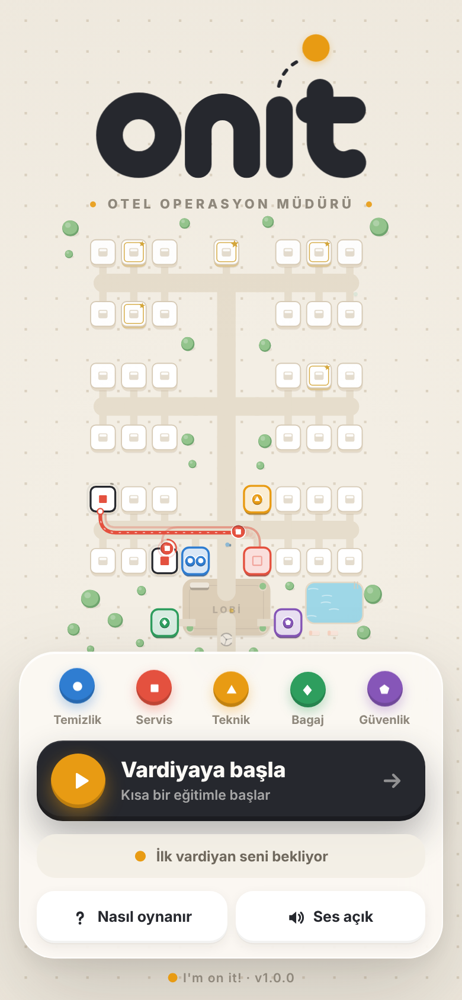
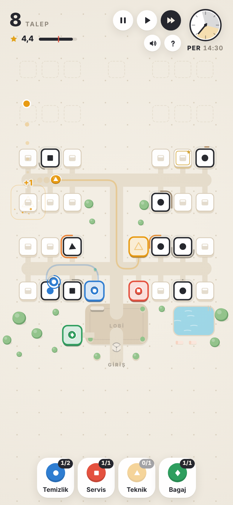

<p align="center">
  
</p>

<p align="center"><b>Otel Operasyon Müdürü</b> · <i>I'm on it!</i></p>

**onit**, Mini Metro tadında, tile tabanlı bir otel operasyon oyunu. Odalarda beliren şekiller misafir talepleridir; doğru ekibi sürükleyip rotalar çizerek oteli ayakta tutarsın. Her gün yeni bir kanat açılır, talepler hızlanır, puanın 2,5★ altına düşerse vardiya biter.

- Bağımlılıksız vanilla JavaScript (ES modülleri) + Canvas 2D, derleme adımı yok
- Yüklenebilir **PWA**: tamamen çevrimdışı çalışır, ana ekrana eklenebilir
- Mobil öncelikli; masaüstü ve yatay ekran desteği

<p align="center">
  
  &nbsp;
  
</p>

## Çalıştırma

ES modülleri ve service worker `file://` üzerinden çalışmaz; yerel bir sunucu gerekir:

```bash
npm start
```

Ardından <http://localhost:8080> adresini açın. (Node yoksa: `python3 -m http.server 8080`.)

Herhangi bir statik barındırma (GitHub Pages, Netlify, Cloudflare Pages…) yeterlidir; tüm yollar görelidir, alt dizinde de çalışır. PWA yüklemesi için HTTPS gerekir (localhost hariç).

## Proje yapısı

```
index.html               HUD + ana menü iskeleti, meta / PWA etiketleri
manifest.webmanifest     PWA manifesti
sw.js                    service worker (sürümlü önbellek, çevrimdışı)
css/
  base.css               belirteçler, sıfırlama
  hud.css                oyun içi arayüz
  menu.css               ana menü
  overlays.css           katman kartları (özet, geliştirmeler, oyun sonu)
  responsive.css         ekran boyutu uyarlamaları
js/
  main.js                giriş noktası + ana döngü
  core/                  utils · config · storage
  world/                 map (tile haritası, yol bulma) · route (rota geometrisi)
  game/                  state · staff · requests · guests · demo · day · upgrades · tutorial · flow · loop
  render/                viewport · palette · shapes · effects · routes · tiles · actors · renderer
  ui/                    hud · overlays · menu · logo
  input/                 sürükle-bırak ve dokunma girdisi
  audio/                 WebAudio ile sentezlenen sesler
  pwa/                   service worker kaydı, güncelleme, yükleme istemi
assets/
  brand/                 logo (PNG + SVG varyasyonları), uygulama işareti, OG görseli
  icons/                 favicon, apple-touch-icon, 192/512 ve maskable ikonlar
  screenshots/           manifest ekran görüntüleri
scripts/check-precache.mjs   sw.js önbellek listesini doğrular
```

## Geliştirme

```bash
npm test        # precache listesi kontrolü + ESLint
```

- **Yeni sürüm yayınlarken** `sw.js` içindeki `VERSION` değerini artırın. Açık sekmelerde menüde *“Yeni sürüm hazır · Yenile”* bildirimi çıkar.
- **Yeni bir css/js dosyası eklerseniz** `sw.js` → `PRECACHE` listesine ekleyin; `npm run check` eksikleri bildirir.
- Geliştirme sırasında service worker önbelleği eski dosyaları sunabilir: DevTools → Application → Service Workers → *Update on reload* seçeneğini açın.
- Konsoldan durum incelemek için `window.__V` (ör. `__V.g`, `__V.startDay(3)`, `__V.spawnReq('H', __V.at(2,9))`).

## Kontroller

| Eylem | Nasıl |
|---|---|
| Personel gönder | Personeli (haritadan, üssünden ya da alttaki ekip kartından) odaya sürükle |
| Çok duraklı rota | Bırakmadan birkaç odanın üstünden geç |
| Yoldaki personele durak ekle | Sürükle ya da dokunup odalara dokun — durak rotanın **sonuna** eklenir |
| Rotayı iptal et | Personeli kendi üssüne bırak |
| Duraklat / hız | `Space` · `1` · `2` |
